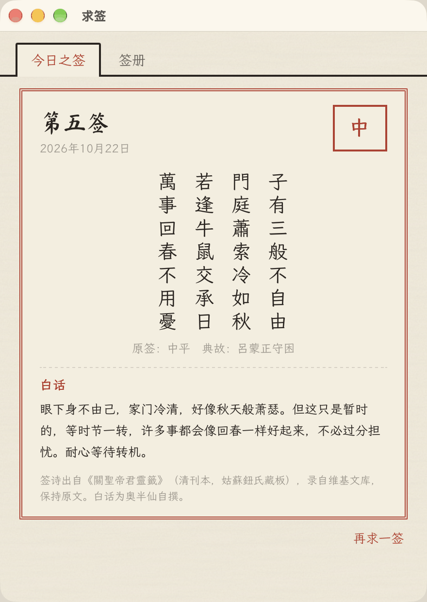
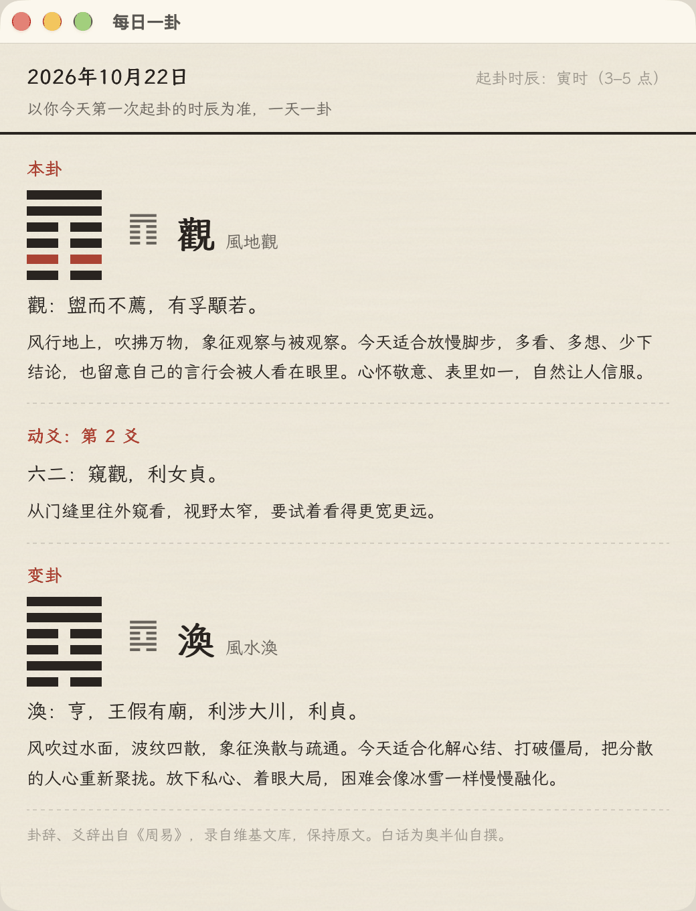
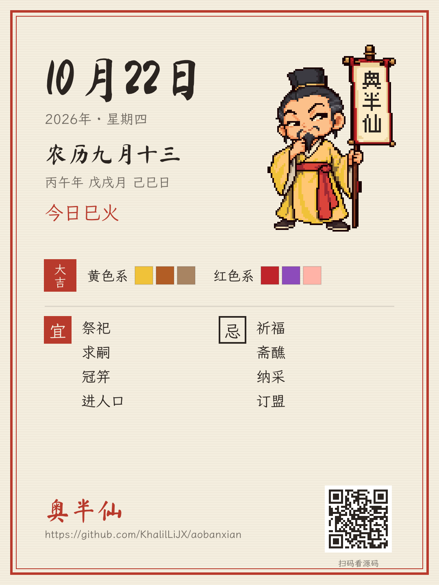

# 奥半仙 Ao Banxian

一个住在桌面上的像素道士。他每天按五行换一身吉色道袍，举着的幡上会写今天宜什么、忌什么；点一下他，幡就展开成一幅挂轴日历。支持 macOS 和 Windows。

<p>
  
</p>
<p>
  
</p>

> 黄历、宜忌、五行穿衣都是传统民俗说法，仅作趣味参考，图个好心情。

## 功能

- **像素道士**：透明背景，默认待在其他窗口下面，像桌面小组件；不占任务栏和 Dock。空白处点击会穿过去落到桌面。按住道士拖动，位置重启后保持。每隔一秒轻轻上下浮动，像在呼吸。
- **每日换色**：当天两个大吉色（相、旺）地位平等，只是在小人身上恰好一个画在道袍、一个画在腰带；按暗、中、亮三档像素色阶替换，色值取自中国传统色。
- **幡上印字**：平时印「奥半仙」。点一下幡，幡晃一下，字按顺序换成 宜事 → 忌事 → 大吉色（如「宜红宜绿」）→ 吉生肖 → 回到「奥半仙」，停 8 秒自动回到第一项。字号按幡面大小自动选：3 个字的字宽约占幡面 75%，4 个字自动缩小到刚好放下。
- **挂轴日历**：点道士身体，幡展开成挂轴：日期、农历、干支、今日五行和两个大吉色系；点纸面看当天详情，点「月历」展开月历，点任意一天看那天的详情。再点道士、按 Esc 或点桌面其他地方就卷回去。
- **每日开场白**：每天第一次见面，道士头顶冒一句话——黄道日「掐指一算，今日黄道吉日」，黑道日「今日宜稳不宜急」；天赦日、传统节日、节气、杨公忌日有各自的说法，幡上也换成对应的字。天赦日和春节，道士周围会闪光。
- **宜忌解释**：详情里把鼠标放在宜忌词上，会解释这个词是什么意思（如「纳采：订婚时男方送聘礼」）。
- **我的生肖**：在设置里选自己的生肖（只存在本机），卡片上显示「今日与你：相合 / 相冲 / 相害 / 平常」，相合、相冲的日子幡上和开场白也会说。
- **择日**：选一件事（搬家、出行、开业、结婚、签约、装修、安床、祭祀）和范围（30 / 60 / 90 天），列出宜做且不忌的日子，标出黄道、天赦，和你生肖相冲的日子变灰。
- **纪念日**：生日、纪念日，公历或农历都行；农历会处理闰月和小月（没有三十按廿九）。列表里显示下次是哪天、还有几天；当天道士会说「今日是妈妈的农历生日」，月历上那一天有小红点，还能用系统通知提前提醒。卡片底部是最近的纪念日、传统节日或节气的倒计时。可以导出 / 导入 JSON。
- **求签**：摇像素签筒，掉出一根签，展开签纸：签号、签等、签诗（《關聖帝君靈籤》原文）和白话解读。每天一签，签册里按日期翻看。
- **每日一卦**：梅花易数按时间起卦（以你今天第一次起卦的时辰为准），显示本卦、动爻、变卦的《周易》原文和白话解读。
- **分享今日**：生成一张 1080×1440 的图（日期、农历、五行、大吉色、宜忌、像素道士、仓库二维码，可附上今日签），复制到剪贴板并存到「图片/奥半仙」。
- **右键菜单**：在道士或卷轴上右键（Mac 双指轻点、Control+点击）：掐指一算、求签、每日一卦 ／ 今日详情、展开 / 收起日历 ／ 择日、纪念日、分享今日 ／ 小人尺寸、置顶、设置 ／ 关于、退出。托盘 / 菜单栏图标里也是同样的菜单。
- **四个角色**：道士（举幡）、书生（摇扇）、青天大老爷（举告示）、小和尚（举木牌）。在设置「外观」里点缩略图就换，站的位置不变；每个角色有自己的口吻（道士称「善信」、书生称「兄台」、青天大老爷「本官宣判」、小和尚称「施主」），右键菜单第一项也跟着变：掐指一算 / 翻翻黄历 / 升堂 / 敲木鱼。青天大老爷的告示会原地展开成日历卡片。
- **敲木鱼**：小和尚的「敲木鱼」会在他身边放一个像素木鱼，「笃」一声，头顶飘「功德 +1」；几秒内点木鱼还能接着敲，累计功德记在本机。
- **设置**：通用、外观、规则、提醒四页，改动即时生效。
- **三种语言**：简体中文、繁體中文、English。英文界面里，宜忌、纳音、干支这些词写成「中文原词 + 英文解释」。

| 收起 | 展开成挂轴 |
| --- | --- |
|  |  |

| 道士 | 书生 | 青天大老爷 | 小和尚 |
| --- | --- | --- | --- |
|  |  |  |  |

| 求签 | 每日一卦 | 分享今日 |
| --- | --- | --- |
|  |  |  |

签诗、卦辞、爻辞录自维基文库（《關聖帝君靈籤》清刊本、《周易》），公有领域，保持原文；白话解读和英文大意是本项目自己写的。

## 安装

到本仓库的 [Releases](../../releases) 下载：

- macOS：`AoBanxian_x.y.z_universal.dmg`（Intel 和 Apple 芯片通用）
- Windows：`AoBanxian_x.y.z_x64-setup.exe`（推荐）或 `AoBanxian_x.y.z_x64.msi`

目前还没有做代码签名，第一次打开时系统会拦一下：

**macOS 提示「无法验证开发者」**
1. 先双击打开一次，在弹窗里点「完成」
2. 打开「系统设置 → 隐私与安全性」，往下找到「已阻止使用"奥半仙"」，点「仍要打开」，再输入密码确认

如果提示「已损坏，无法打开」，在终端运行一次下面的命令再打开：

```bash
xattr -dr com.apple.quarantine /Applications/奥半仙.app
```

**Windows 提示「Windows 已保护你的电脑」（SmartScreen）**
点「更多信息」→「仍要运行」。Windows 10 如果没有 WebView2，安装程序会自动下载。

## 本机运行开发版

需要先装好：

- [Node.js](https://nodejs.org/) 20 以上
- [Rust](https://www.rust-lang.org/tools/install)（`curl --proto '=https' --tlsv1.2 -sSf https://sh.rustup.rs | sh`）
- macOS 需要 Xcode 命令行工具；Windows 需要 Microsoft C++ 生成工具和 WebView2（见 [Tauri 前置条件](https://tauri.app/start/prerequisites/)）

```bash
npm install
npm run tauri dev
```

第一次运行要编译 Rust 依赖，需要几分钟。其他常用命令：

| 命令 | 作用 |
| --- | --- |
| `npm test` | 单元测试（规则、历法、精灵图换色、点击分区、布局、设置、多语言） |
| `npm run day [YYYY-MM-DD]` | 在终端打印某一天的完整结果，方便拿老黄历核对 |
| `npm run dev` | 只在浏览器里打开界面（http://localhost:1420） |
| `VITE_FAKE_TODAY=2026-10-01 npm run tauri dev` | 把「今天」固定成某一天，看特殊日子的效果 |
| `npm run fonts` | 重新收集字表并给字体做子集（需要 python3） |
| `npm run tauri build` | 打包安装包 |

## 怎么用

| 操作 | 结果 |
| --- | --- |
| 点幡 | 幡晃一下，换下一项文字（英文界面旁边会冒翻译小气泡） |
| 点道士 | 轻跳一下，幡展开成挂轴日历；再点卷回去 |
| 点挂轴纸面 | 看当天详情 |
| 点「月历」 | 展开月历，点任意一天看那天的详情 |
| 按住道士拖动 | 移动位置（移动超过 4 像素才算拖动） |
| 右键道士或挂轴 | 弹出菜单 |
| Esc / 点桌面其他地方 | 收起 |

## 穿衣规则

### 当日五行：默认按日支

默认取当天**日支**的五行，比如 2026-10-22 是己巳日，巳属火，就是「巳火」，大吉色是黄色系和红色系（幡上「宜黄宜红」）。日支是每天轮换的十二地支之一，在民间择日、生肖冲合里用得最多，和挂轴上的「吉生肖 / 今日冲」也是同一套依据，所以作为默认推荐。

另外两种取法也保留在设置的「规则」页里，因为民间确实有人这样用：

- **纳音**：老黄历上每天印着的五行，如「大林木」。六十甲子每两天共用一个纳音，很多老黄历和穿衣口诀按它来
- **日干**：当天天干的五行，如己日属土。有些流派以天干为主

不管选哪种，界面上只写结果（如「今日巳火」），取法只在设置里出现。纳音始终作为黄历信息显示在详情里（「纳音：大林木」），不参与配色。

### 旺相休囚死

设当日五行为 D，按「旺相休囚死」给五个五行分档：

| 状态 | 与 D 的关系 | 档位 | 例：木日 |
| --- | --- | --- | --- |
| 旺 | 与 D 相同 | 大吉 | 木 |
| 相 | D 所生 | 大吉 | 火 |
| 休 | 生 D 者 | 平 | 水 |
| 囚 | 克 D 者 | 慎穿 | 金 |
| 死 | D 所克 | 不宜 | 土 |

「相」和「旺」都是大吉，地位平等。幡面、卡片、详情、解释句里统一**相在前、旺在后**（被日所生的颜色在前，同气的在后）：木日写成「大吉 红色系 · 绿色系」，幡上写「宜红宜绿」。小人身上恰好一个颜色画在道袍、一个画在腰带，由 `topPriority` 决定哪个占大面积。

### 规则配置（`rules/default.json`）

| 字段 | 可选值 | 含义 |
| --- | --- | --- |
| `elementSource` | `branch`（默认） | 取日支的五行，如巳日 → 火 |
| | `nayin` | 取日柱纳音的最后一个字，如「大林木」→ 木 |
| | `stem` | 取日干的五行，如己日 → 土 |
| `topPriority` | `xiang`（默认） | 小人身上「相」的颜色占大面积。两个都是大吉，这只影响小人怎么画 |
| | `wang` | 「旺」的颜色占大面积 |
| `dayBoundary` | `midnight`（默认） | 午夜 0:00 换日 |
| | `zi` | 23:00 子时换日 |
| `tierLabels` | 字符串 | 四档的显示文字：`best` 大吉、`neutral` 平、`caution` 慎穿、`avoid` 不宜 |
| `colorFamilies` | 每个五行 `{ name, char }` | 色系名（界面显示，如「红色系」「黑蓝色系」）和单字（幡上、解释句用，如「红」「黑」） |
| `palettes` | 每个五行一组 `{ name, traditional, hex }` | 色系，**第一个颜色是代表色**。`traditional` 是对应的中国传统色名 |
| `pixelRamps` | 每个五行三档 `{ level, traditional, hex }` | 像素道士换色用的 暗 / 中 / 亮 色阶，要在同一个色系里。金（白）的暗部用暖灰才看得出褶皱，水用藏青系避免糊成一团 |
| `explanation` | 一条模板 | 解释句，两个大吉色一起说，如「今日巳火：火生土，火为同气，黄、红皆为大吉」。占位符：`{label}` `{D}` `{wang}` `{xiang}` `{xiu}` `{qiu}` `{si}` `{wangChar}` `{xiangChar}` `{wangFamily}` `{xiangFamily}` |
| `xiuLuckLabels` | `{ "吉": "...", "凶": "..." }` | 值日星宿吉凶的显示文字（界面不出现「凶」字） |
| `tips` | 每个五行一组字符串 | 挂轴上的小贴士，按日期轮换 |

前三项也可以在设置窗口的「规则」页里改，改动只存在你自己电脑上，不改这个文件。四档文字、解释句、星宿吉凶、小贴士在简体界面直接用这个文件；繁体和英文用语言文件里的 `rulesText`。

默认色系（括号里是取色用的中国传统色，色值各家资料略有出入，欢迎指正）：

- 木：绿（松柏绿） 青（青碧） 翠（葱青） 浅绿（艾绿） 墨绿（松花绿）
- 火：红（银朱） 紫（紫色） 粉（粉红） 橙（橙色）
- 土：黄（缃色） 棕（棕色） 卡其（驼色） 米（牙色） 咖啡（褐色）
- 金：白（象牙白） 金（赤金） 银（银白） 香槟（缟）
- 水：黑（漆黑） 蓝（靛蓝） 藏青（藏青） 灰（苍色）

### 欢迎补充你的流派

五行穿衣在民间本来就有不同说法：有人按日支，有人按纳音或日干；有人认为「旺」最吉，有人认为「相」最吉；换日也有午夜和子时两种算法；每个五行对应哪些颜色，各家也不完全一样。这些分歧都做成了配置项。如果你家用的是另一套说法，欢迎提 PR：在 `rules/` 下新增一个 JSON 文件，写清楚出处或依据，并在测试里补上对应的用例。

## 幡上的字与开场白

都在配置里，fork 后可以改成自己的：

- `config/branding.json`：幡上平时的文字 `bannerText`（默认「奥半仙」）、宜忌前缀、大吉色的写法（`luckyColors`，默认「宜{first}宜{second}」）、「诸事不宜」「百无禁忌」、特殊日子的幡面文字。幡上的字是画的一部分，所有语言下都保持中文
- `config/branding.json` 的 `author`、`repository`：作者的 GitHub 用户名和仓库地址（关于窗口、分享图上的地址和二维码都从这里读）
- `assets/character/<id>/character.json` 的 `voice`：每个角色的开场白和右键菜单第一项（三种语言）

特殊日子同一天重合时，按 天赦日 > 传统节日 > 节气 > 杨公忌日 取一个：

| 特殊日子 | 规则 | 幡上 | 开场白 |
| --- | --- | --- | --- |
| 天赦日 | 春戊寅、夏甲午、秋戊申、冬甲子（季节按立春、立夏、立秋、立冬划分） | 天赦日 | 今日天赦，百无禁忌 |
| 传统节日 | 春节、元宵、龙头节、端午、七夕、中秋、重阳、腊八、除夕 | 节日名 | 掐指一算，今日某某节 |
| 节气 | 二十四节气当天 | 节气名 | 今日某某，顺时而行 |
| 杨公忌日 | 农历正月十三、二月十一、三月初九、四月初七、五月初五、六月初三、七月初一、七月廿九、八月廿七、九月廿五、十月廿三、十一月廿一、十二月十九 | 宜静 | 今日诸事从简 |

值神（黄道 / 黑道）、节气、节日来自 lunar-javascript；天赦日和杨公忌日按上面的规则实现，2026 年的 6 个天赦日已与公开的日历核对。

## 如何贡献新语言

1. 复制 `locales/en.json` 为新的语言文件，比如 `locales/ja.json`，逐条翻译。`rulesText` 是四档文字、解释句、星宿吉凶和小贴士的译文
2. 在 `locales/glossary.json`（术语表）里给每个词加一个该语言的字段，比如 `"纳采": { "en": "Betrothal gifts", "ja": "..." }`。术语表收录了宜忌、纳音、节气、节日、二十八宿、值神、颜色、天干地支、生肖、方位等文化专有词，翻译时可以参考英文和繁体
3. 在 `src/i18n/index.ts` 里注册新语言（`resources`、`resolveSystemLang`），在 `src/i18n/terms.ts` 里决定这些词的显示格式（英文是「中文原词 · 英文解释」）
4. 在 `locales/*.json` 的 `settings.languageOptions` 里加上语言名
5. 运行 `npm test`：测试会检查所有语言的键完全一致、术语表没有遗漏
6. 运行 `npm run fonts`，把新语言用到的字加进字体子集

繁体中文由 `scripts/i18n/build-zh-tw.ts` 用 OpenCC 从简体转换（界面用台湾用词，历法和宜忌逐条转换、保持传统写法），再人工修正，修正写在脚本的 `UI_FIXES` / `TERM_FIXES` / `KEY_FIXES` 里。

## 历法数据

农历、节气、干支、纳音、宜忌、冲煞、二十八宿、值神全部来自 [6tail/lunar-javascript](https://github.com/6tail/lunar-javascript)（MIT 协议），本项目不自己实现历法算法。年干支按立春换年，月干支按节换月。生肖六合、三合、六冲用对照表实现，测试里与 lunar-javascript 的日冲逐日核对过。

## 关于

- 作者、仓库地址：见 [`config/branding.json`](config/branding.json) 的 `author`、`repository`
- 协议：代码以 [MIT](LICENSE) 开源；字体各自遵循 SIL Open Font License 1.1
- 致谢：
  - [lunar-javascript](https://github.com/6tail/lunar-javascript)（6tail）——历法数据
  - [霞鹜文楷 LXGW WenKai](https://github.com/lxgw/LxgwWenKai)——正文
  - [马善政毛笔楷书 Ma Shan Zheng](https://github.com/googlefonts/mashanzheng)、[志莽行书 Zhi Mang Xing](https://github.com/googlefonts/zhimangxing)——大字
  - [Fusion Pixel 缝合像素字体](https://github.com/TakWolf/fusion-pixel-font)（含 Ark Pixel、Cubic 11、Galmuri）——幡上像素字
  - [EB Garamond](https://github.com/googlefonts/ebgaramond)——英文正文
  - [OpenCC](https://github.com/BYVoid/OpenCC) / [opencc-js](https://github.com/nk2028/opencc-js)——繁简转换
  - [维基文库](https://zh.wikisource.org/)——《[關聖帝君靈籤](https://zh.wikisource.org/wiki/%E9%97%9C%E8%81%96%E5%B8%9D%E5%90%9B%E9%9D%88%E7%B1%A4)》签诗、《[周易](https://zh.wikisource.org/wiki/%E5%91%A8%E6%98%93)》卦辞爻辞（公有领域原文）
  - [qrcode-generator](https://github.com/kazuhikoarase/qrcode-generator)（Kazuhiko Arase，MIT）——离线二维码

字体文件是按本项目用字做的子集，许可全文在 `src/assets/fonts/`。

---

## English

**Ao Banxian** (奥半仙, "Half-Immortal Ao") is a pixel-art Taoist who lives on your desktop (macOS / Windows). Every day he wears robes in the "lucky colours" of the Five Elements, and the banner he holds shows the day's suggested and avoided activities from the traditional Chinese almanac. Click the banner to flip through its messages; click him and the banner unrolls into a hanging-scroll calendar with the lunar date, stem-branch, element of the day and a month view. He greets you each morning (auspicious "Yellow Path" days, the Day of Heavenly Pardon, festivals and solar terms each have their own line), and right-clicking him opens a native menu: draw a daily fortune lot (poems from the public-domain *Guansheng Dijun Lingqian*), cast the day's I Ching hexagram (Meihua time method, original *Zhouyi* text), pick auspicious days for moving, weddings and more, keep birthdays and anniversaries (lunar dates included, with system notifications), and export a 1080×1440 "share today" card. Four characters to choose from — the Taoist, a scholar with a fan, a magistrate with a notice board, and a little monk who taps a wooden fish for "Merit +1" — each with their own voice. Plain-language readings of the lots and hexagrams are our own writing.

The UI is available in Simplified Chinese, Traditional Chinese and English; in English, culture-specific terms are shown as "Chinese original · English gloss" (see `locales/glossary.json`). Calendar data comes from [lunar-javascript](https://github.com/6tail/lunar-javascript); the colour rules live in `rules/default.json` and are fully configurable, since folk traditions differ — PRs adding other schools are welcome. Everything here is folk tradition, just for fun.

```bash
npm install
npm run tauri dev   # run the desktop app
npm test            # unit tests
```

Builds are unsigned for now: on macOS, allow it under System Settings → Privacy & Security → "Open Anyway"; on Windows, click "More info" → "Run anyway" in SmartScreen.

License: MIT (code). Bundled fonts (LXGW WenKai, Ma Shan Zheng, Zhi Mang Xing, Fusion Pixel, EB Garamond) are subsets under the SIL Open Font License 1.1.
